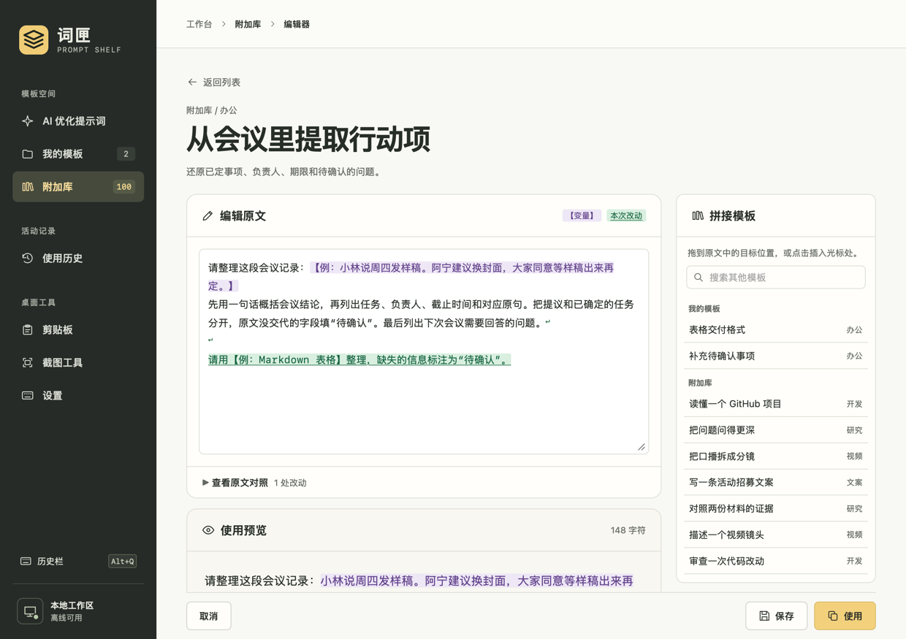

# 词匣 · Prompt Shelf

词匣是一款适用于 macOS 和 Windows 的本地提示词工具。把常用提示词存成模板，需要时改几处原文、拼入另一段，复制到正在使用的 AI 工具。它也能找回其他应用里复制过的内容、截取滚动长图，并把参考图置顶在工作窗口旁。

## 下载词匣 1.4.0

| 系统 | 安装包 | 安装方式 |
| --- | --- | --- |
| macOS 14 及以上 · Apple Silicon 和 Intel | [下载通用 DMG（0.94 MiB）](https://github.com/liulrc/prompt-shelf/releases/download/v1.4.0/PromptShelf-1.4.0-macOS-universal.dmg) | 打开 DMG，将「词匣」拖入「应用程序」，从那里启动。 |
| Windows 10 1809 及以上、Windows 11 · x64 | [下载 Setup.exe（2.41 MiB）](https://github.com/liulrc/prompt-shelf/releases/download/v1.4.0/CiXia-1.4.0-Windows-x64-Setup.exe) | 双击安装到当前用户。缺少 WebView2 时，安装器会联网补装。 |

**从 1.3.0 或更早版本升级**，请先从菜单栏或系统托盘退出词匣，再手动安装一次 1.4.0。此后可以在 **设置 → 软件更新** 中检查新版、查看说明，点击 **更新并重启**。词匣会下载对应安装包、校验 SHA-256、安装并重新启动。也可开启「空闲时自动安装更新」。该选项默认关闭，编辑草稿或截图期间会暂缓重启。[最新发布](https://github.com/liulrc/prompt-shelf/releases/latest) · [1.4.0 安装包校验清单](https://github.com/liulrc/prompt-shelf/releases/download/v1.4.0/SHA256SUMS.txt)

Mac 包使用临时签名，尚未公证，首次打开可能出现开发者验证提示。Windows 安装包尚无发布者签名。Mac 首次截图需授权屏幕录制，使用自动滚动还需授权辅助功能。[安装与权限说明](docs/桌面版使用说明.md#安装和首次使用)

## 选一条模板，改完就用

1.4 的工作台把**模板列表和使用预览并排显示**，选中就能看到将要复制的全文。可在「我的模板」中搜索自己的内容，也可在「附加库」按用途查找。附加库有 100 条中文模板，视频、文案、开发、办公、研究各 20 条。部分模板的创作参考了 MiniMax Design 公开案例和社区原帖。[附加库选材与来源](docs/附加库来源.md)

以「读懂一个 GitHub 项目」为例，打开后可以直接改写括号中的示例。

> 详细阅读并【例：学习/部署】【例：GitHub】上的【例：https://github.com/Vincentwei1021/video-shotcraft】项目。

- **直接使用**会复制预览中的文字。想针对自己的项目提问，点击 **编辑原文**，把任务改成「部署」，再换成自己的仓库地址。
- **拼接模板**时，可以把编辑器右侧的另一条模板拖到光标处。示例用紫色标出，本次改写用绿色高亮，展开「查看原文对照」还能看到删掉的字。
- **使用**会复制本次内容，并在「使用历史」中保留全文。**保存**会写入「我的模板」，从附加库改写的内容会另存为个人模板。**取消**会退出本次编辑。

## 用自己的模型优化提示词

在 **设置 → AI 模型** 填写兼容 OpenAI 协议的服务地址及所需密钥。拉取模型列表后，可勾选一个或多个模型，也可手动添加模型名。

在工作台打开 **AI 优化提示词**，输入草稿并点击「一键优化」。英文草稿也会默认优化为中文提示词，草稿中对最终任务的语言要求仍会保留。例如，要求写英文邮件时，生成的中文提示词仍会要求模型用英文写邮件。多个模型的结果可分别复制或送入编辑器。

## 剪贴板、长截图与全局快捷键

| 功能 | macOS | Windows | 常用操作 |
| --- | --- | --- | --- |
| 截图 | Option + A | Alt + A | 框选后可直接复制、保存或置顶。需要截整页时切换到「滚动长截图」，完成后可进入独立编辑窗加文字、画框、划线或涂马赛克。 |
| 剪贴板历史 | Option + Q | Alt + Q | 在卡片弹窗中搜索文字、图片或视频文件。用方向键选择、回车恢复到剪贴板，回原窗口即可粘贴。 |
| 近期截图库 | Option + Z | Alt + Z | 选择一张或多张截图同时置顶。每张图都能单独移动，拖动边角可等比缩放。 |
| 我的模板 | Option + X | Alt + X | 随时唤出个人库，再按一次可收起，重新打开可继续编辑。 |

四组快捷键都可以在 **设置 → 通用** 修改。截图原图会进入本机剪贴板历史。给副本加马赛克后，可从编辑窗复制或导出。Mac 关闭工作窗口后仍在后台运行，并从 Dock 隐藏。按 ⌘Q 或选择「退出词匣」可结束程序。[查看新版剪贴板界面](docs/剪贴板预览.png)

## 本地数据与技术实现

模板、使用历史、剪贴板和截图库均保存在本机，可离线使用。开启剪贴板记录后，可以从菜单栏或系统托盘暂停。主动使用 AI 优化时，本次输入会发送给你配置的模型服务。密钥保存在 macOS 系统钥匙串中，Windows 使用当前用户的 DPAPI 加密存储。

macOS 使用 Swift、AppKit 和系统 WebKit，Windows 使用 C++、Win32 和 WebView2，两端共用 Rust 长截图拼接模块。1.4.0 已在 macOS 隔离副本验证更新替换、重启回执与失败回滚。Windows 版已完成交叉构建、更新协议测试和安装包校验，实际安装、回滚与重启仍待 Windows 系统验证。[桌面版使用与构建说明](docs/桌面版使用说明.md) · [1.4 产品审视与设计参考](docs/产品审视与改版.md) · [早期网页原型](docs/网页原型.md)
