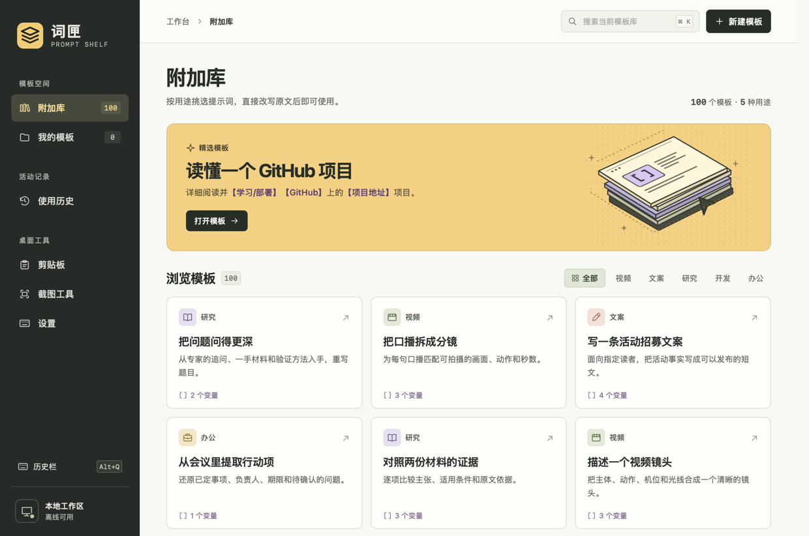

# 词匣 · Prompt Shelf

词匣是 macOS 和 Windows 上的本地桌面工具。把反复使用的 AI 提示词存为模板，改几个字就能复制到正在使用的 AI 工具。它也能找回之前复制的内容、截取滚动页面，并把参考图置顶在其他窗口旁。日常使用无需账号或模型 API 密钥。

## 下载安装

| 平台 | 1.2.0 安装包 | 安装方式 |
| --- | --- | --- |
| macOS 14 及以上，Apple Silicon / Intel | [下载通用 DMG · 733 KiB](https://github.com/liulrc/prompt-shelf/releases/download/v1.2.0/PromptShelf-1.2.0-macOS-universal.dmg) | 打开 DMG，把「词匣」拖入「应用程序」，从那里启动。 |
| Windows 10 1809 及以上或 Windows 11，x64 | [下载 Setup.exe · 2.37 MiB](https://github.com/liulrc/prompt-shelf/releases/download/v1.2.0/CiXia-1.2.0-Windows-x64-Setup.exe) | 运行安装程序。缺少 WebView2 时，安装器会联网补装。 |

升级前请先退出正在运行的词匣。Mac 首次截图需要允许屏幕录制，自动滚动还需允许辅助功能。当前 macOS 包使用临时签名，Windows 包尚无发布者签名。[版本说明与 SHA-256](https://github.com/liulrc/prompt-shelf/releases/tag/v1.2.0) · [安装及 Mac 升级权限说明](docs/桌面版使用说明.md)

## 用一次模板

1. 打开「附加库」，按用途挑一条模板。视频、文案、开发、办公、研究各有 20 条，共 100 条。
2. 直接编辑原文。例如，把「读懂一个 GitHub 项目」里的 `【例：学习/部署】` 改成「部署」，再把示例地址换成自己的项目。示例和本次改写分别用颜色提示。
3. 点 **使用**，将这次改好的文字复制到剪贴板，并在「使用历史」保留本次全文。想长期复用就点 **保存**，附加库里的模板会另存到「我的模板」。点 **取消** 可放弃本次修改。

模板编辑页附有来源说明，包括 MiniMax Design 公开案例和社区高分原帖。[查看案例来源与选材记录](docs/附加库来源.md)

## 四个全局快捷键

| 功能 | macOS | Windows | 打开后可以做什么 |
| --- | --- | --- | --- |
| 我的模板 | Option + X | Alt + X | 打开个人库。写到一半也可以收起，再打开继续改。 |
| 剪贴板历史 | Option + Q | Alt + Q | 搜索复制过的文字、图片和视频文件。选中卡片并回车，回到原窗口即可粘贴。 |
| 截图与长截图 | Option + A | Alt + A | 拖出选区，截取一张图，或切到「滚动长截图」。在独立编辑窗中画框、划线、加文字或涂马赛克。 |
| 近期截图库 | Option + Z | Alt + Z | 一次选择多张截图置顶。每张图都能独立移动、等比缩放和关闭。 |

四组快捷键均可在「设置」中修改。再按同一组合可收起对应窗口。框选或滚动中再按截图键会取消本次截取，进入截图编辑窗后再按则最小化并保留标注。

## 数据与实现

模板、使用历史、剪贴板和截图保存在本机。可以在菜单栏或托盘菜单暂停剪贴板自动记录。截图完成后原图会自动归档，加了马赛克的图片可从编辑窗复制或导出。详情见[本地存储与使用说明](docs/桌面版使用说明.md)。

macOS 使用 Swift、AppKit 和系统 WebKit，Windows 使用 C++、Win32 和 WebView2，两端共用 Rust 编写的长截图拼接逻辑。[构建与验证说明](docs/桌面版使用说明.md#构建) · [浏览器原型](docs/网页原型.md)
